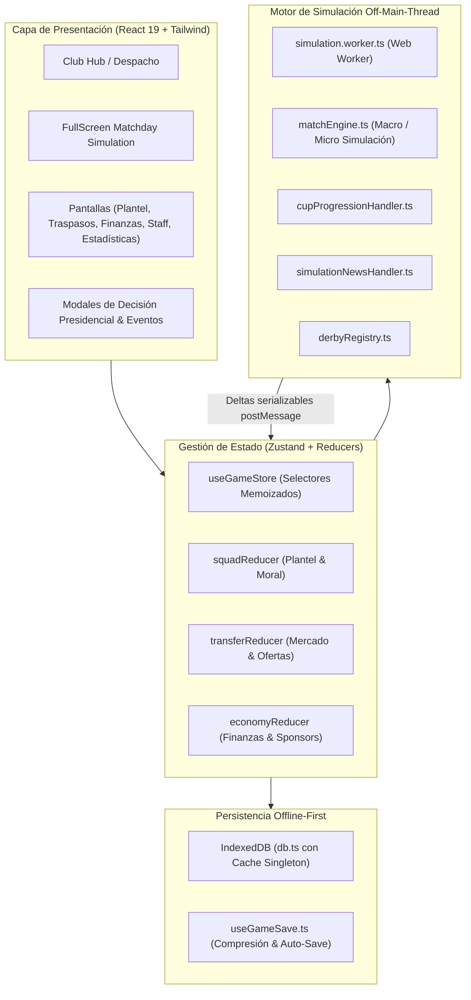

<div align="center">
  

  # ⚽ Apex AI: Football President 💼

  **El simulador definitivo de presidencia y gestión deportiva.**  
  *Donde el poder institucional, la alta política futbolística y el destino de un club residen en tu despacho.*

  [](https://apex-futbol.vercel.app)
  [](https://react.dev/)
  [](https://www.typescriptlang.org/)
  [](https://vitejs.dev/)
  [](https://tailwindcss.com/)
  [](https://github.com/Extremer12/Apex-futbol)

  [Jugar Online](https://apex-futbol.vercel.app) • [Características](#-características-principales) • [Arquitectura Técnica](#-arquitectura-técnica) • [Instalación](#-instalación-y-desarrollo) • [Licencia](#-licencia)

</div>

---

## 📖 Visión del Juego

En la mayoría de los videojuegos de fútbol asumes el papel de un Director Técnico. En **Apex AI: Football President**, asumes el cargo más poderoso, influyente y exigente de una institución deportiva: **El Presidente del Club**.

Tus responsabilidades van mucho más allá de un once inicial: debes ganar elecciones democráticas ante los socios cada 4 años, diseñar la política de fichajes, contratar y evaluar al cuerpo técnico, administrar presupuestos multimillonarios, ampliar el estadio, firmar contratos de patrocinio de élite y tomar decisiones tácticas cruciales desde el palco en pleno día de partido.

---

## 🌟 Características Principales

### 🏛️ 1. Sistema Presidencial & Política de Club
- **Mandato Democrático de 4 Años**: Cada 4 temporadas debes someter tu gestión a las urnas. Los socios evalúan tu mandato en base a títulos, salud financiera, fichajes y cumplimiento de promesas.
- **Debate de Campaña & Promesas Electorales**: Define tu identidad institucional prometiendo campeonatos, estrellas galácticas, remodelaciones de infraestructura o austeridad responsable.
- **Aprobación de Socios & Confianza de la Junta**: Métricas de respaldo político dinámicas que fluctúan tras cada victoria, clásico, balance contable y conferencia de prensa.

### 🏟️ 2. Matchday Interactivo & Modo Palco Presidencial
- **Simulación en Pantalla Completa**: Retransmisión televisiva inmersiva con cronómetro en tiempo real, radar de momentum anímico, ticker de comentarios y banners cinematográficos de gol.
- **Controles de Velocidad Dinámicos**: Cambia fluidamente entre velocidades `1x`, `2x` y `4x` o salto instantáneo sin desincronizar el minutero.
- **Intervenciones en Vivo desde el Palco**: Pausas estratégicas en el entretiempo (45') o minuto 70' para girar indicaciones al Director Técnico:
  - ⚡ *Adelantar líneas y asfixiar con presión alta.*
  - 🛡️ *Bloque bajo disciplinado y enfriar el ritmo.*
  - 💼 *Inyección anímica extraordinaria: prima económica por victoria.*
- **Atmósfera de Clásicos & Factor Estadio**: Registro oficial de derbis históricos (Superclásico, El Clásico, Derbi de Milán, Manchester Derby, etc.) con cálculo de aforo, tensión ambiental y ventaja de localía ponderada.

### 🏆 3. Competiciones y Formatos Oficiales
- **Ligas Domésticas**:
  - **Liga Argentina**: Torneo Apertura, Torneo Clausura, Tabla Anual acumulada, Sistema de Promedios y descenso directo.
  - **Ligas Europeas de Élite**: Premier League, LaLiga, Serie A, Bundesliga y Ligue 1.
  - **Ligas de las Américas**: Brasileirão y Liga MX.
- **Copas Internacionales**:
  - **UEFA Champions League (Formato Suizo 2026)**: Fase liga única de 36 clubes, clasificación directa a octavos y playoffs eliminatorios de 16vos.
  - **Copa Libertadores & Sudamericana**: Fase de grupos continental y cruces de ida y vuelta a doble partido.
  - **Copa Intercontinental**: Duelo global definitivo por la corona del mundo.
- **Galardones Individuales**: Gala de fin de temporada con entrega de **Balón de Oro**, **Bota de Oro**, **Guante de Oro** y **Mejor Jugador de la Temporada (MVP)**.

### 💼 4. Mercado de Fichajes & Mundo Vivo IA
- **Negociaciones Complejas**: Negocia con clubes y representantes de jugadores acordando tarifas de transferencia, cláusulas de rescisión, primas de firma y salarios semanales.
- **Mercado Dinámico Autónomo**: Durante los períodos de transferencias abiertos (verano e invierno), los clubes controlados por la IA realizan movimientos de compraventa independientes entre sí.
- **Evolución, Envejecimiento & Regens**: Progresión de rating basada en edad, declive gradual de veteranos y generación constante de jóvenes promesas en academias.

### 🧑‍💼 5. Cuerpo Técnico Integral (Staff Deportivo)
Administra cinco departamentos clave del club contratando profesionales con impacto directo en el rendimiento:
1. **Director Técnico**: Define el estilo táctico (Ofensivo, Defensivo, Posesión, Equilibrado) y gestiona las convocatorias.
2. **Preparador Físico**: Reduce la fatiga post-partido y acelera la recuperación de condición física.
3. **Jefe del Cuerpo Médico**: Disminuye la probabilidad de lesiones graves y acorta los tiempos de baja.
4. **Director Deportivo**: Optimiza los costos de traspaso y agiliza las negociaciones en el mercado.
5. **Jefe de Ojeadores**: Acelera la precisión y velocidad del informe de scouting de futbolistas internacionales.

### 💰 6. Economía 2.0 & Infraestructura
- **Patrocinios Multianuales**: Negocia acuerdos de indumentaria, patrocinador principal de camiseta y derechos de nombre del estadio (*Naming Rights*).
- **Gestión de Infraestructura**: Invierte en la ampliación de capacidad del estadio, mejora de instalaciones y fija el precio de las entradas para maximizar la taquilla.
- **Presupuestos Escalonados**: Control de balance neto, masa salarial, costes de mantenimiento semanal e ingresos por derechos televisivos.

### 🏛️ 7. Sala de Trofeos & Museo del Club
- Vitrina interactiva con representaciones de trofeos de competiciones nacionales e internacionales.
- Registro cronológico detallado de títulos ganados, subcampeonatos y récords históricos.

### 🎨 8. Sistema de Recursos & Packs de la Comunidad
- Motor de carga modular para packs comunitarios: escudos de clubes, logotipos de torneos y fotos de jugadores verificadas.
- Sistema de seguridad con verificación de manifiestos, moderación y hashes de integridad.

---

## 🏗️ Arquitectura Técnica

El juego está diseñado con una arquitectura **Offline-First**, orientada a rendimiento extremo en navegadores modernos y dispositivos móviles:



### Tecnologías Utilizadas
- **Frontend Core**: React 19, TypeScript 5, Vite 6.
- **Estilos & UI**: Tailwind CSS, Lucide Icons, Canvas Confetti.
- **Concurrencia**: Web Workers dedicados para cálculo de jornadas, ligas y copas simultáneas sin congelar el hilo principal de la UI (*zero dropped frames*).
- **Persistencia**: IndexedDB con índices optimizados por `careerId` y caché singleton.
- **Testing**: Suite nativa Node.js / `tsx --test` con **60 tests automatizados** de integración y regresión.

---

## 📁 Estructura del Código

```text
Apex-ai/
├── components/
│   ├── gameflow/           # Pantalla completa de simulación de partidos y cinemáticas
│   ├── screens/            # Pantallas principales (ClubHub, Squad, Transfers, Staff, Finances, Stats, etc.)
│   ├── ui/                 # Componentes atómicos y modales de eventos / reuniones
│   └── icons/              # Iconografía personalizada y SVG helpers
├── services/
│   ├── simulation/         # Motor de partidos, generador de fixtures, progreso de copas y derbis
│   ├── customPacks/        # Gestor de recursos comunitarios y fotos de jugadores
│   ├── eventEngine.ts      # Motor de crisis institucionales y dilemas de prensa
│   ├── seasonManager.ts    # Pipeline de cierre de temporada, ascensos/descensos y galardones
│   ├── db.ts               # Capa de almacenamiento en IndexedDB
│   └── gameLogic.ts        # Fórmulas de valoración, IA de mercado y sponsors
├── state/
│   ├── gameStore.ts        # Zustand Store con selectores finos
│   ├── reducer.ts          # Root GameReducer
│   └── reducers/           # Reducers temáticos (squadReducer, transferReducer, etc.)
├── workers/
│   └── simulation.worker.ts # Web Worker de simulación semanal en segundo plano
├── tests/                  # Tests unitarios y de integración de todo el ecosistema
└── types.ts                # Contratos y tipos TypeScript estrictos del juego
```

---

## 🚀 Instalación y Desarrollo Local

### Requisitos Previos
- **Node.js**: v18.0.0 o superior
- **npm** o **pnpm**

### Pasos de Instalación

1. **Clonar el repositorio**:
   ```bash
   git clone https://github.com/Extremer12/Apex-futbol.git
   cd Apex-futbol
   ```

2. **Instalar dependencias**:
   ```bash
   npm install
   ```

3. **Iniciar el servidor de desarrollo**:
   ```bash
   npm run dev
   ```
   Abre [http://localhost:5173](http://localhost:5173) en tu navegador.

4. **Ejecutar la suite de pruebas**:
   ```bash
   npm test
   ```

5. **Compilar para producción**:
   ```bash
   npm run build
   ```

---

## 🛡️ Calidad de Código y Pruebas

El proyecto cuenta con **60 pruebas automatizadas** que validan rigurosamente:
- ✅ Transiciones seguras entre temporadas consecutivas sin bloqueos de semanas infinitas.
- ✅ Funcionamiento fiel del formato suizo de la UEFA Champions League 2026.
- ✅ Sistema de ascensos, descensos y desempate por promedios en la Liga Argentina.
- ✅ Algoritmos de ordenamiento de zonas con garantía de separación de rivales históricos (Boca Juniors vs River Plate).
- ✅ Cierre de temporada sin copas inconclusas (*"En Disputa"*).
- ✅ Integridad del motor de guardado en IndexedDB con prevención de carreras y duplicados.
- ✅ Aislamiento de seguridad y sanitización de paquetes de recursos comunitarios.

---

## 👨‍💻 Autor y Créditos

Desarrollado y mantenido por **[Extremer12](https://github.com/Extremer12)**.  
*Inspirado por la pasión del fútbol mundial y la complejidad de la gestión institucional.*

---

## 📄 Licencia

Este proyecto está bajo la Licencia **MIT**. Consulta el archivo `LICENSE` para más información.
